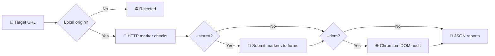

<div align="center">

```
██╗  ██╗███████╗███████╗███████╗███╗   ██╗████████╗██╗███╗   ██╗███████╗██╗
╚██╗██╔╝██╔════╝██╔════╝██╔════╝████╗  ██║╚══██╔══╝██║████╗  ██║██╔════╝██║
 ╚███╔╝ ███████╗███████╗█████╗  ██╔██╗ ██║   ██║   ██║██╔██╗ ██║█████╗  ██║
 ██╔██╗ ╚════██║╚════██║██╔══╝  ██║╚██╗██║   ██║   ██║██║╚██╗██║██╔══╝  ██║
██╔╝ ██╗███████║███████║███████╗██║ ╚████║   ██║   ██║██║ ╚████║███████╗███████╗
╚═╝  ╚═╝╚══════╝╚══════╝╚══════╝╚═╝  ╚═══╝   ╚═╝   ╚═╝╚═╝  ╚═══╝╚══════╝╚══════╝
```

### 🛡️ Marker-based XSS checks, locked to your local lab

*Learn, test, and verify cross-site scripting defenses, safely, on an app you control.*


[Features](#-features) •
[Safety First](#-safety-first) •
[Install](#-install) •
[Usage](#-usage) •
[Reports](#-reports) •
[How It Works](#-how-it-works)

</div>

---

## ✨ Features

| | Feature | Description |
|---|---|---|
| 🎯 | **Marker-based checks** | Uses harmless markers to detect unsafe reflection, with no weaponized payloads |
| 🔒 | **Local-only by design** | Accepts only `localhost`, `127.0.0.1` and `::1`; everything else is rejected |
| 🚧 | **Redirect containment** | HTTP redirects that leave the configured local origin are blocked |
| 💾 | **Stored mode** | Optional `--stored` flag submits markers to local form fields to check for persistence |
| 🌐 | **DOM audit** | Optional `--dom` flag drives real Chromium via Playwright to inspect the rendered DOM |
| 🧱 | **Browser sandboxing** | Cross-origin browser requests are blocked during the DOM audit |
| 📄 | **JSON reports** | Machine-readable output for both HTTP and DOM findings |

---

## 🛑 Safety First

> **XSSentinel is built for intentionally vulnerable test applications that you own and control.**

- ✅ Targets allowed: `localhost`, `127.0.0.1`, `::1`
- ❌ Targets rejected: every other hostname and IP address
- ❌ Redirects and browser requests leaving the local origin are blocked

> ⚠️ **Heads up:** `--stored` mode submits markers to local form fields and **may change data** in the test application. Use disposable test data only.

---

## 📦 Install

```powershell
python -m pip install -r XSSential\requirements.txt
python -m playwright install chromium
```

<details>
<summary><b>📚 Dependencies</b></summary>

| Package | Version | Purpose |
|---|---|---|
| `requests` | `>=2.31,<3` | HTTP client for scanning |
| `beautifulsoup4` | `>=4.12,<5` | HTML parsing and form discovery |
| `playwright` | `>=1.45,<2` | Chromium automation for the DOM audit |
| `colorama` | `>=0.4.6,<1` | Colored terminal output |

</details>

---

## 🚀 Usage

**Basic scan**

```powershell
python XSSential\scanner.py --url http://127.0.0.1:8000
```

**Full scan: stored checks and DOM audit**

```powershell
python XSSential\scanner.py --url http://localhost:8000 --stored --dom
```

### 🎛️ Options

| Flag | Description |
|---|---|
| `--url` | Local target to scan (`localhost`, `127.0.0.1` or `::1` only) |
| `--stored` | Also submit harmless markers to local form fields (may modify test data) |
| `--dom` | Also run the Chromium-based DOM audit (cross-origin requests blocked) |

---

## 📊 Reports

Results are written to disk as JSON:

| Scan type | Output file |
|---|---|
| 🌐 HTTP findings | `XSSential\reports\reports.json` |
| 🧬 DOM audit | `XSSential\reports\dom-report.json` |

---

## 🧠 How It Works



---

## 🧪 Good Targets

Run XSSentinel against apps built to be broken, on your own machine, such as a local copy of a deliberately vulnerable training app or your own dev build.

---

<div align="center">

**Built for learning. Scoped for safety. Test only what you own.** 🛡️

</div>
